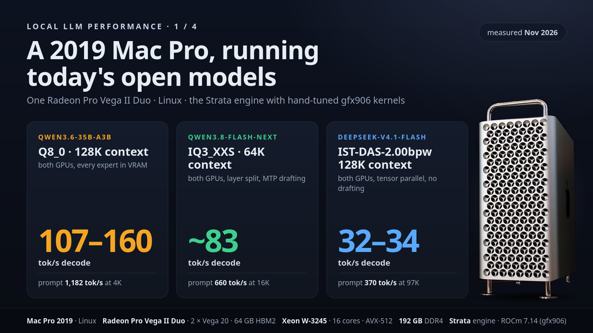
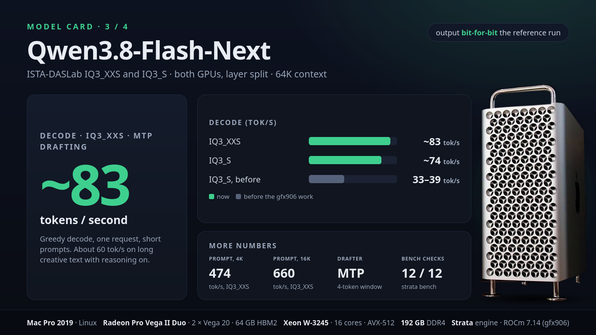
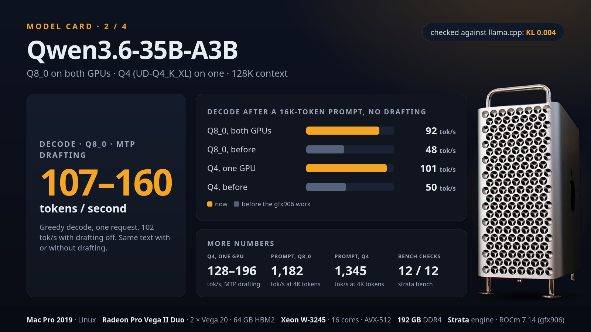
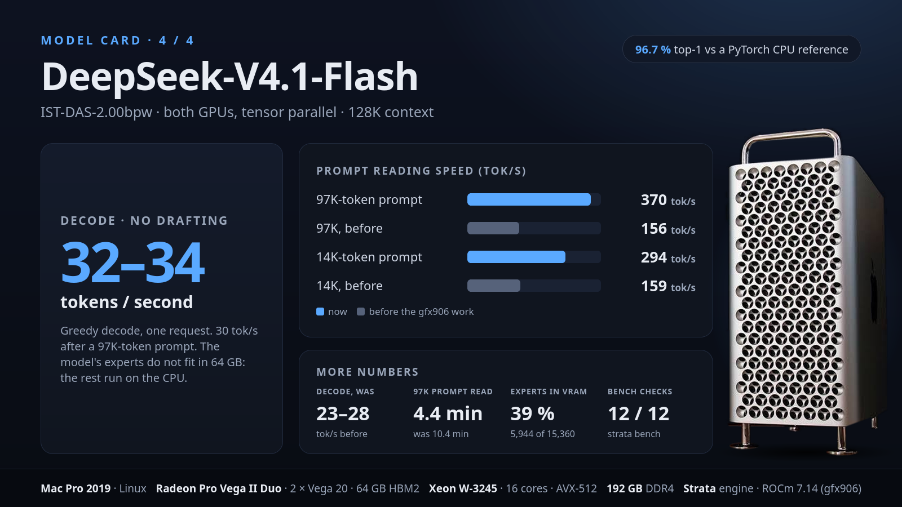

# Mac Pro 2019 on Linux: Radeon Pro Vega II Duo (gfx906)

This fork ([steddyman/Strata](https://github.com/steddyman/Strata)) adds hand-written gfx906 kernels and a gfx906 desktop
app (AppImage). It was built and measured on one machine, and the defaults are tuned for it:

| | |
| --- | --- |
| Computer | Mac Pro 2019 (MacPro7,1) |
| GPU | Radeon Pro Vega II Duo: two Vega 20 (gfx906) dies, 32 GB HBM2 each (64 GB in total), about 1 TB/s each, joined by an Infinity Fabric (XGMI) link |
| CPU | Intel Xeon W-3245, 16 cores / 32 threads, AVX-512 (Cascade Lake) |
| Memory | 192 GB DDR4-2933, six channels |
| OS | Ubuntu 26.04 with the t2linux kernel (`7.3.3-2-t2-resolute`), the kernel's own `amdgpu` driver |
| ROCm | 7.14 for gfx906 from TheRock's nightly wheels (AMD's own releases no longer ship gfx906) |

Other gfx906 cards (Instinct MI50 / MI60, Radeon VII, Radeon Pro VII) use the same kernels, but none of the numbers below
were measured on them. A smaller GPU or less RAM changes what fits: DeepSeek in particular needs the 192 GB.



The cards on this page sum up the tables below; the tables say which engine and settings each number comes from.

## What this fork changed, in short

The stock engine's GPU kernels are written for NVIDIA cards and compiled for AMD through HIP. On Vega 20 they ran at about
100 GB/s of weight traffic a die, an eighth of what its memory can read. The speed here comes from three things: the GPU
clock, kernels written for gfx906, and changes to each model's decode and prompt paths. Every number below was measured on
the machine above.

**The clock.** The driver's power level was pinned at `low`. On `auto` the same engine went from 50.9 to 70.9 tok/s
(Qwen3.8 IQ3_S, engine 0.1.59.10). See the next section.

**What the gfx906 kernels do differently.**

- **All 64 lanes.** A Vega 20 wavefront has 64 lanes; the CUDA-shaped kernels use 32. The new kernels give each row of a
  matrix a group of lanes and sum across lanes with the chip's own row operations (DPP).
- **Wide loads, issued first.** The old kernels were limited by the count of small loads (1 and 4 bytes), not by bytes.
  The new ones read 16 bytes at a time straight from the GGUF blocks, with no repacking and no extra VRAM, and issue
  every load of a lane before its first use, which hides the memory's latency.
- **Activations in local memory.** Each block of rows copies the activations into the GPU's local store (LDS) once,
  so the rows do not read them again from VRAM.
- **Few registers.** A kernel that needs 88 or more vector registers halves the waves a SIMD unit can hold. The kernels
  stay at 64 or fewer.
- **Fewer launches.** Many steps took several small launches a layer, each mostly fixed latency. Steps were merged
  where that measured faster.

**Which kernels.**

| Step | Formats or parts | Used by |
| --- | --- | --- |
| Dense rows (GEMV) | Q4_K, Q5_K, Q6_K, Q8_0, IQ4_XS, BF16; rows of up to 6,144 inputs | all three models |
| Expert gate/up and down | IQ2, IQ3_XXS, IQ4_NL down, Q4_K / Q5_K | Qwen3.8, Qwen3.6 |
| Hyper-connections | norm, down and up in two kernels, not six launches | Qwen3.8 |
| Router, residual norm, MoE combine, GDN rows | FP32 | Qwen3.6 |
| Decode attention | one block for the 8 query heads of a KV head | Qwen3.6 |
| Decode attention, split K / V | | DeepSeek |
| Prompt expert kernels | F16 dot products, not F32 | DeepSeek |

One Q6_K row kernel alone went from 112 to 48 µs (10240 x 2560, one token), but that moved decode only about 2 %: the
time was spread over about 35 launches a layer, so every step had to move.

**What changed per model.**

| Model | Change | Measured |
| --- | --- | --- |
| Qwen3.8-Flash-Next | The kernels above, then the clock | IQ3_S 39 → 50.9 tok/s on `low`, 74.5 on `auto` |
| | MTP drafting on Auto, not DFlash2 | 71–77 against 55–58 tok/s |
| Qwen3.6-35B-A3B | The attention kernel reads each K / V row once, not 8 times | after a 16K prompt, Q8_0: 48 → 92 tok/s |
| | Q4 on one die, not split over two | about 7 % faster |
| DeepSeek-V4.1-Flash | No huge-page request for the experts' RAM copy (it froze both dies for seconds) | 8–30 tok/s run to run → steady |
| | Tighter expert slots: 11 % more experts in VRAM | 5,355 → 5,955 experts a die |
| | A prompt's experts moved into VRAM before decode | CPU lane 17 % → 8 % of picks after a 13.9K prompt |
| | Split-KV decode attention | attention 31.9 → 26.7 ms a token after a 13.9K prompt |
| | All of the decode changes together | 23–28 → 32–34 tok/s |
| | Long prompts skip layers 20–39 for most rows; F16 expert kernels; whole-matrix copies | 97K prompt: 156 → 370 tok/s |

**What did not change.** A build for another card is the same as before: the new defaults apply only in a gfx906 build,
and each has a switch back (`STRATA_G906_*=0`, `STRATA_Q36_G906=0`, `STRATA_GFX906_DEFAULTS=0`, the `DS4_*` switches named
below). The kernels sum in another order than the shared ones, so outputs match to float rounding, not bit for bit;
[Quality checks](#quality-checks) has the comparison. The working logs are [GFX906_KERNEL_PLAN.md](GFX906_KERNEL_PLAN.md),
[QWEN36.md](QWEN36.md#gfx906-vega-20-radeon-pro-vii-mi50-vega-ii) and
[DEEPSEEK41.md](DEEPSEEK41.md#gfx906-mac-pro-2019-radeon-pro-vega-ii-duo).

## Before you start: let the GPUs clock up

**This is the most important setting on this machine.** The amdgpu driver has a power level per card,
`/sys/class/drm/cardN/device/power_dpm_force_performance_level`. On this Mac Pro a udev rule
(`/etc/udev/rules.d/30-amdgpu-pm.rules`) set it to `low`, which holds the shader clock at **999 MHz**. The Vega II boosts to
**1,730 MHz** on `auto`. With the same engine, Qwen3.8-Flash-Next went from 50.9 to 70.9 tok/s (37.3 → 27.3 ms a verify
window) when the level went from `low` to `auto`. Every number in this guide is measured on `auto`.

Check it:

```bash
cat /sys/class/drm/card*/device/power_dpm_force_performance_level
```

Each AMD card should print `auto`. If one prints `low` (or `profile_min_sclk` / `profile_min_mclk`):

1. Set `auto` now (until the next reboot):

   ```bash
   echo auto | sudo tee /sys/class/drm/card*/device/power_dpm_force_performance_level
   ```

2. Make it stick. Find the rule that sets it:

   ```bash
   grep -rl power_dpm_force_performance_level /etc/udev/rules.d /lib/udev/rules.d
   ```

   In that file change `"low"` to `"auto"`. This machine's rule now reads:

   ```
   KERNEL=="card[012]", SUBSYSTEM=="drm", DRIVERS=="amdgpu", ATTR{device/power_dpm_force_performance_level}="auto"
   ```

   Then reload the rules (or reboot):

   ```bash
   sudo udevadm control --reload && sudo udevadm trigger --subsystem-match=drm
   ```

3. Restart Strata.

**The app warns you.** When an AMD card reports one of the low levels, the **Model** page shows "Your AMD GPU clocks are
held at their lowest setting", naming the cards, with these commands under **How to fix it**. The check reads the level when
the app starts, so restart the app after changing it.

The cards draw more power and run warmer on `auto`; the **Monitor** page shows each card's temperature, clock and power if
you want to check them.

## Install

1. Build the AppImage, or take one built from this fork:

   ```bash
   packaging/build_appimage_gfx906.sh --appimage <official Strata-<ver>-linux-x86_64.AppImage>
   ```

   It writes `Strata-<ver>-gfx906-linux-x86_64.AppImage` with the gfx906 engine package inside
   (see [AMD_HIP.md](AMD_HIP.md#gfx906-instinct-mi50--mi60-radeon-vii-wave64-built-from-source)). The engine package holds
   the Qwen engine (Qwen3.8-Flash-Next and Qwen3.6-35B-A3B), the DeepSeek-V4.1 engine (`strata-dsv41`) and the picture
   readers. Its version is `<engine version>.<GFX906_REV>`, for example 0.1.59.18.
2. Start it. The app installs the bundled engine on first start; nothing is fetched from the update feed for gfx906.
3. Pick a model, set one die as **Main** and the other as **Helper**, and load it. Models already in `~/Documents/Strata`
   are checked locally, not downloaded again.

## What runs, and how fast

Decode is greedy generation on a single request at the stated context; prompt is prefill speed.

### Qwen3.8-Flash-Next (both dies, layer split, MTP drafting)



The prompt speeds on the card (474 tok/s at 4K tokens, 660 at 16K, IQ3_XXS) were read from the app's log on engine
0.1.59.18, two runs at each length.

| Pack | Decode | Engine |
| --- | ---: | --- |
| ISTA-DASLab IQ3_XXS | **~83 tok/s** | 0.1.59.15 |
| ISTA-DASLab IQ3_S | **~74 tok/s** | 0.1.59.11 |
| IQ3_S before this work (stock 0.1.59.1, clocks `low`) | 33–39 tok/s | |

Drafting on **Auto** uses the MTP layer, not DFlash2, on gfx906 (MTP was 71–77 tok/s against DFlash2's 55–58), with
two pipelined verify windows. Expect less on long, creative text with reasoning on: a ~500-word story at 64K context read
about 60 tok/s in the app, because fewer drafted tokens are accepted. Q2_0 and IQ2_XS packs have gfx906 kernels too, but were
not measured end to end. How it was done: [GFX906_KERNEL_PLAN.md](GFX906_KERNEL_PLAN.md).

### Qwen3.6-35B-A3B (128K context)



| | Q4 (UD-Q4_K_XL), one die | Q4, both dies | Q8_0, both dies |
| --- | ---: | ---: | ---: |
| Decode, MTP drafting (the app's default) | 128–196 tok/s | 115–188 | 107–160 |
| Decode, no drafting | 114 | 106 | 102 |
| Prompt, 4K tokens | 1,345 | 1,318 | 1,182 |
| Decode after a 16K prompt, no drafting (engine 0.1.59.20) | 101 | | 92 |
| Decode after a 16K prompt, no drafting (0.1.59.19 and before) | 50 | | 48 |

- Q4 fits on one die and is about 7 % faster there; select both cards for Q6 / Q8_0, which need both (the layers split
  across the dies, every expert in VRAM).
- Checked against llama.cpp (KL 3.3e-3 for Q4, 3.8e-3 for Q8_0); Q4 on two dies is bit-for-bit the one-die output, and
  drafting gives the same text as no drafting.
- Up to 0.1.59.19 decode halved after a 16K prompt: each of the 16 query heads read the shared K / V cache on its
  own, 8 times the bytes. 0.1.59.20 reads it once for the 8 heads of a KV head (32K prompt: 31 -> 89 tok/s on one die).
- Not tested on two dies: Q6, pictures.
- Details: [QWEN36.md](QWEN36.md#gfx906-vega-20-radeon-pro-vii-mi50-vega-ii).

### DeepSeek-V4.1-Flash (both dies, tensor parallel, ISTA-DAS 2.00 bpw general set)



Decode, drafting **Off**, 256 tokens after a prompt of each length (engine 0.1.59.21, 128K context allowed):

| Prompt | Decode | Before (0.1.59.20) | Prompt speed | Before |
| --- | ---: | ---: | ---: | ---: |
| 24 tokens | **31.9 tok/s** | 28.0 (8–20 in about 4 runs of 10) | | |
| 3.8K tokens | **31.8 tok/s** | | **184 tok/s** | 143 |
| 13.9K tokens | **34.4 tok/s** | 25.2 | **294 tok/s** | 159 |
| 97K tokens | **29.8 tok/s** | 23.5 | **370 tok/s** (4.4 min) | 156 (10.4 min) |

The prompt speeds are for a prompt read in one piece, as the server reads it, and include the settle after it.

Earlier engines: 0.1.59.18 read prompts at 22 / ~36 tok/s (3.8K / 13.9K); the first gfx906 run (layer split) decoded at
19–21 tok/s.

What 0.1.59.21 changed, in the order it mattered:

- **No more freezes.** The engine asked Linux for huge pages for its 86 GB copy of the experts. That makes the kernel
  compact memory, and compaction moves pages of the host memory the GPU driver has mapped; each move stops every queue
  of the process until the pages are mapped again. A kernel trace showed both dies frozen for 1–6 s at a time (18 s in
  256 tokens), in about 4 runs of 10. Without the request: 20 runs of 20 at 27.3–28.2 tok/s (`DS4_ANON_THP=1` asks again).
- **The experts a prompt uses are moved into VRAM before decode starts.** Four swap threads, 32 swaps under way, and a
  settle after the prompt of about 7 % of its time (0.8 s at least, 5 s at most). After a 13.9K prompt the CPU lane served
  17 % of the expert picks; now 8 % (`DS4_CACHE_THREADS`, `DS4_CACHE_INFLIGHT`, `DS4_SETTLE_MS`).
- **11 % more experts in VRAM.** Each die's slot was sized for the wider 1280 share of an expert even on layers where it
  holds 1024. Now 5,955 of 15,360 experts a die (was 5,355) (`DS4_TP_TIGHT=0` restores the old layout).
- **The split-KV decode attention** (`ds4_attn_split.cuh`, opt-in elsewhere): the decode's attention 31.9 → 26.7 ms a
  token over both dies after a 13.9K prompt (`DS4_ATTN_SPLIT=0` turns it off).
- **Fewer launches a token, bit-identical:** the Q5_K GEMV rounds its own activations when every job of a call is one
  (31.1 → 31.9 tok/s, `DS4_G906_Q5K_FQ=0`), and the router picks its 6 experts in one pass. Putting the pre-norm into
  the hyper-connection mix launch measured slower (30.3), so that one is opt-in (`DS4_G906_HCNORM=1`).
- **Long prompts skip layers 20–39 for all but their last 2,668 rows**, as on one GPU (`DS4_YOCO_TP=0` turns it off): the
  same tokens after a 13.9K prompt, read at 216 tok/s instead of 155.
- **The prompt's expert kernels in F16** by `v_dot2_f32_f16` (`DS4_G906_SET16=0`: the F32 kernel): 4.3 → 8.1 TFLOPS, their
  time on a 13.9K prompt 41.3 → 17.8 s.

- **Prompts:** up to 0.1.59.18 each die's share of every streamed expert's down matrix crossed PCIe as 4,096 short rows,
  a copy that runs at 0.05 GB/s on gfx906, so a 3,000-token prompt waited ~2.5 minutes. 0.1.59.19 copies the whole
  matrix (13 GB/s) and cuts the share out on the GPU (`DS4_DOWN_BOUNCE=0` restores the old copy). After 0.1.59.21 a
  13.9K prompt's GPU time is experts 71 % (with the waits for streamed ones), attention 23 %, the shared expert 5 %.

- About 51 GB of the 132 GB of experts sit in VRAM (39 % of them); the rest run on the Xeon's AVX-512 (a Cascade Lake build of the i-quant
  kernels, since the W-3245 lacks VBMI / VPOPCNTDQ). The Engram table is read from the SSD. This is why it needs the 192 GB.
- Both dies compute every layer (tensor parallel over each expert's hidden width, split unevenly as 1280 + 1024).
- **Set Drafting to Off.** The DSpark drafter makes it slower here (13–21 tok/s): each drafted token roughly triples the CPU
  lane's expert work.
- Up to 0.1.59.20 speed varied from run to run (8–30 tok/s): the freezes above. A freeze can still happen when the kernel
  compacts memory for another reason (1 run of about 30 since); close large programs before loading it. The first load
  reads about 130 GB and takes several minutes.
- The engine needs about 95 GB of RAM beside the page cache. Under memory pressure Ubuntu's `systemd-oomd` kills the whole
  group of processes the engine was started from, so start a test run of `strata-dsv41` in its own scope:
  `systemd-run --user --scope strata-dsv41 ...`.
- Details: [DEEPSEEK41.md](DEEPSEEK41.md#gfx906-mac-pro-2019-radeon-pro-vega-ii-duo).

## Quality checks

Run on 12 November 2026 with the engines above, both dies, GPU power level `auto`:

| Model | Functional checks (`strata bench run`, 12 cases) | Logits |
| --- | --- | --- |
| Qwen3.8-Flash-Next IQ3_XXS | 12 / 12 | `tools/quant_quality.py` against the gated 0.1.59.15 run: 100 % top-1, KL 0 (bit-for-bit) |
| Qwen3.6-35B-A3B Q8_0 | 12 / 12 | against llama.cpp: KL 3.8e-3 |
| DeepSeek-V4.1-Flash 2.00 bpw | 12 / 12 | against `tools/dsv41/ref_gguf.py` (an independent PyTorch forward on the CPU, 428 tokens of prose and code): 96.7 % top-1, mean KL 0.008, perplexity 6.54 vs the reference's 6.58 |

The functional checks are instruction following (JSON and exact text), retrieval from 4K and 16K prompts, and tool
calls ([BENCHMARK_PROTOCOL.md](BENCHMARK_PROTOCOL.md)). The benchmark's speeds at 4K / 16K prompts: Qwen3.6 Q8_0
reads 1,073 / 899 tok/s and decodes 84 / 47 tok/s (engine 0.1.59.18; 0.1.59.20 decodes ~92 after the 16K prompt); Qwen3.8 IQ3_XXS reads 475 / 661 and decodes 78 / 72; DeepSeek read
only 19 / 36 tok/s on engine 0.1.59.18 (a 3,000-token prompt waited about 2.5 minutes for its first token; 143 / 159 tok/s
since 0.1.59.19, see above) and decodes 28 at every length. Engine 0.1.59.21, the same benchmark on 13 November 2026
(12 / 12 again, the prompts read, not restored from saved conversations): prompts 193 / 316 tok/s, decode 32 / 32 tok/s,
first token after 15 s / 38 s (it was 157 s / 337 s), the whole benchmark 8 min 38 s.

To repeat the DeepSeek check (the reference needs `torch` (CPU) and llama.cpp's `gguf-py`; one pass of 428 tokens took
72 minutes and ~35 GB of RAM):

```bash
strata-dsv41 --pack PACK --gpus 0,1 --ids @text.ids --n 1 --max-context 8192 --dspark none --dump-logits engine.f32
python tools/dsv41/ref_gguf.py --pack PACK --ids "$(cat text.ids)" --dump ref.npz --no-hs --dev cpu
python tools/dsv41/compare.py --ref ref.npz --engine engine.f32
```

## Where the time goes, and what's left

- **Qwen3.8:** at `auto` clocks each die is busy ~70–77 % of a window; the rest is the cross-die and host round trip and the
  drafter's chain, not kernel time.
- **DeepSeek:** about 1,700 small kernels per token on each die (5–50 µs each, mostly fixed latency) and 6–8 ms of CPU
  lane (11 ms after a 97K prompt). A trace of a 32 ms token on one die: the two dies' sums and the wait for the CPU lane
  ~9 ms, the Q5_K GEMVs 4.9, activation quantising 2.1, the expert gate/up and down kernels 3.8, attention ~2, about
  700 launches of kernels under 12 µs ~7. The next gains are fusing those small launches and porting the Qwen gfx906
  expert kernels (`g906_gu_kernel`, `g906_down_kernel`).
- **DeepSeek, short prompts:** a prompt of a few hundred tokens reads at 40–70 tok/s, a long one at 300 or more. A read
  of 96 tokens or more copies every expert that is not in VRAM to the dies, used or not, so it has a cost of several
  seconds that does not shrink with the prompt. A 555-token read took 11.2 s; its GPU time over both dies was experts
  15.0 s (with the waits for copies), attention 0.95 s, routing and the shared expert 0.19 s. `DS4_SKIP_UNPICKED=1`
  copies only the experts the prompt picks. It still copied 55 % of them at 555 tokens, and it is not a clear win: 128
  tokens 2.8 → 4.5 s, 340 tokens 9.1 → 7.3 s, 555 tokens 11.2 → 8.9 s, 1,032 tokens 13.0 → 12.6 s, 3,000 tokens
  18.3 → 20.9 s (engine 0.1.59.21, 14 November 2026, one run each, a new engine start for every run, so each includes
  first-prompt costs). It stays off. Not built: computing the experts that few tokens use on the CPU, as decode does.
- **Qwen3.6:** remaining ideas are the shared-expert gate/up, the router top-k and a recurrent-layer kernel that spills
  registers (roughly 10 % together).

Every gfx906 path keeps a switch back to the generic kernel (`STRATA_G906_*=0`, `STRATA_Q36_G906=0`); they are listed in the
linked documents.
